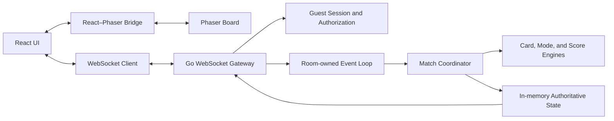

# System Architecture Overview

Status: BASELINE. This document summarizes `docs/REQUIREMENT.md` §18–20 and §30–31; those sections remain authoritative.

## Deployment shape

The MVP is a monorepo with a React/TypeScript/Vite web client and a single Go modular-monolith Game Server. The server uses standard `net/http`, WebSocket communication, and in-memory active Room/Match state. One server instance owns active Rooms. Database, Redis, microservices, Kubernetes, and distributed game servers are not MVP requirements.

## Client boundaries

- React owns navigation, guest entry, Room and Lobby views, forms, scoreboard, timer display, results, settings, responsive layout, and translated messages.
- Phaser owns gameplay-board presentation, card interaction intent, animation, visual effects, and game audio.
- A controlled React–Phaser bridge sends render state into Phaser and returns player intentions. The client never owns authoritative score, timer, card validity, or Match outcome.
- A WebSocket client manages versioned messages, request identifiers, state versions, connection state, snapshots, and incremental updates.

## Server boundaries

The Go monolith separates Guest Session, Room Management, Match Coordinator, Action Processor, Card Engine, Game Mode Engine, Score Engine, WebSocket Gateway, Security, Configuration, and State Management responsibilities. Core card and scoring logic must remain independent of UI and transport.

## Authority and data flow

The client submits an intention. The server authenticates and authorizes the session, validates membership and Match state, applies the action to authoritative state, then publishes an authorized snapshot or event. Private board state is sent only to its owner; permitted public scores may be broadcast to the Room.

## Concurrency and lifecycle

The recommended baseline is one authoritative event loop per Room; state mutations within a Room are sequential and different Rooms operate concurrently. Bounded queues and slow-client handling must prevent network writes from blocking Room processing. Queue limits, overflow policy, and idempotency retention require technical design before implementation. Room and Match cleanup must release timers, connections, and reserved player slots according to the requirements.

## Security and operations

Use unpredictable secure HttpOnly guest credentials, validate WebSocket Origin and every protected action, bound payloads/connections/queues, rate-limit sensitive operations, and exclude secrets from logs. Production uses HTTPS/WSS and same-origin routing behind a reverse proxy or equivalent. The in-memory MVP does not recover active Matches after process restart.

## Decisions

Material decisions and deviations are recorded as ADRs under `architecture/decisions/`. This overview does not approve protocol details or change gameplay requirements. See `REQUIREMENT.md` §§18–20 for the baseline and unresolved design constraints.
